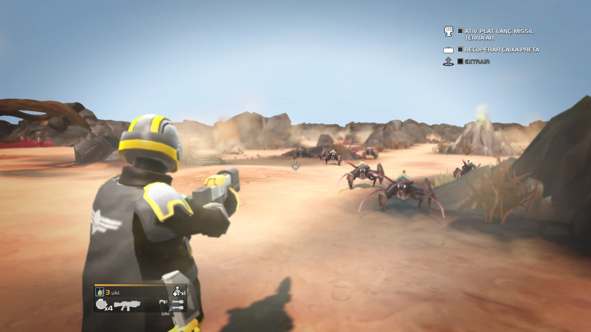
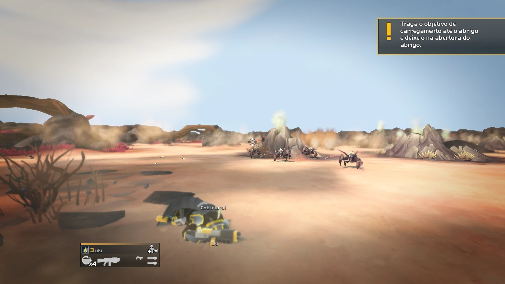
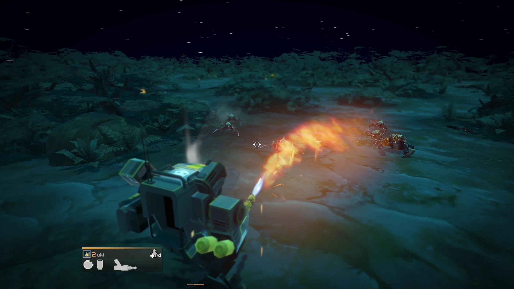
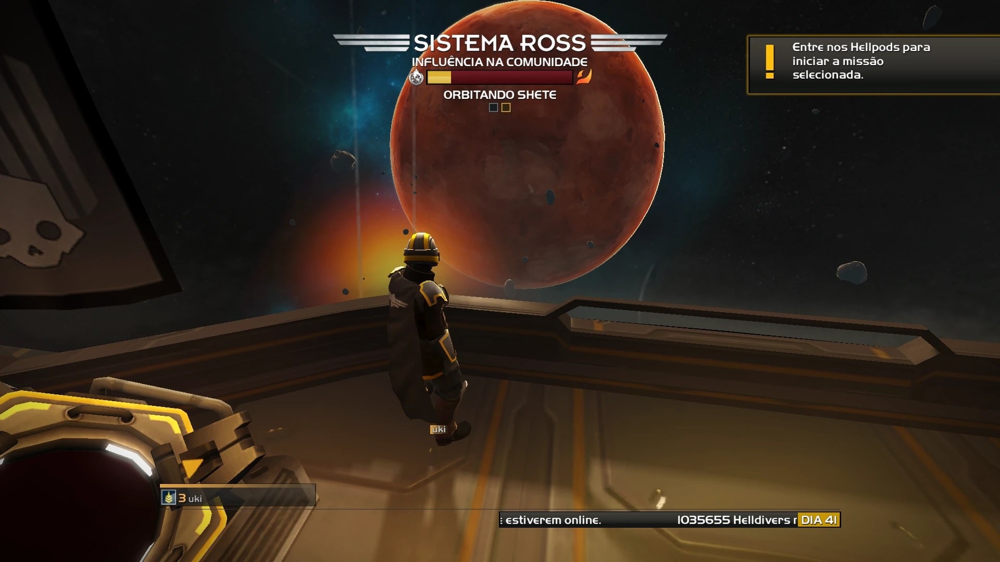
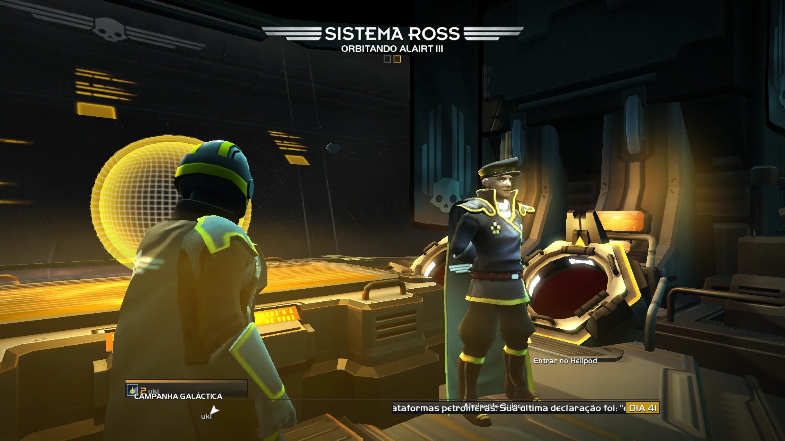
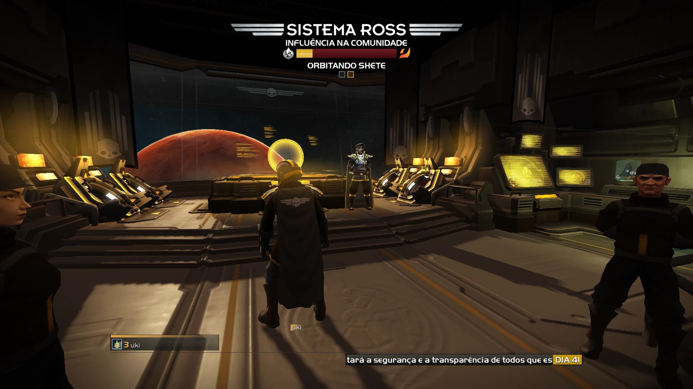

# Third Person Camera (HD2 Style) for HELLDIVERS

Play **HELLDIVERS (Dive Harder Edition)** with the over-the-shoulder camera of **HELLDIVERS 2**.

**[⬇ Download v1.0](https://github.com/yukiorsrs/third-person-camera-helldivers/releases/latest)**



## What it does

The top-down view is replaced by an over-the-shoulder camera with free mouse aim, and the world was adjusted so it looks right from the ground: a real sky, your Super Destroyer above you and a few cinematic moments.

- Shoulder camera with free mouse look and a center crosshair
- Aim (right mouse) brings the camera to your shoulder and zooms in
- The camera doesn't clip through rocks and walls
- Cameras for the mech, APC, bike, turrets and seats
- Your upper body follows your aim and bullets go where you point
- Grenades and stratagems land where you aim
- Smoother HD2-style dive
- A real sky for every biome, a starry night sky and a sunset for dusk and dawn
- Your Super Destroyer in the sky, with hellpods and orbital strikes coming from it
- Hellpod descent camera and extraction camera
- Camera shake on explosions and a taller stratagem beam
- HUD labels only show when you look at them
- The ship lobby uses the shoulder camera too

## Screenshots

| | |
|---|---|
|  |  |
|  |  |



## Install

1. Download the zip from [Releases](https://github.com/yukiorsrs/third-person-camera-helldivers/releases/latest) and extract it.
2. Open the `ThirdPersonCamera_Installer` folder, run `ThirdPersonCamera_Installer.exe` and click **Install**.
3. Play.

The installer finds the game in any Steam library and closes it if it's open. It only changes your own game files and keeps a backup of every original in `Helldivers\contents\hd2cam_backup`. Run it again and click **Uninstall** to remove the mod. Verifying the game files on Steam also works.

If the game gets an update, uninstall and install again. The installer won't touch files it doesn't recognize.

## About this repository

This is the source code of the installer:

- `installer.py` is the whole installer (GUI, game detection, patching, backup and uninstall).
- `data/lua/*.bin` are the mod's compiled scripts, which replace scripts in the game's script bundles.
- `data/sky/*.dds` are the sky textures added to the biome bundles. The night sky is generated by `installer.py` at install time.
- `data/originals.json` lists the game files the mod touches with their SHA-256. The installer refuses to patch anything that does not match.

It has no network access, no registry writes and does not touch any file outside the game's `contents` folder. A few antivirus engines flag PyInstaller executables; that is a known false positive.

### Build

Requirements: Windows, Python 3.12, PyInstaller 6.22.3.

```
python -m pip install pyinstaller==6.22.3
python -m PyInstaller --noconfirm --onedir --windowed --noupx --name ThirdPersonCamera_Installer --version-file version_info.txt --add-data "data;data" installer.py
```

The installer is created in `dist/ThirdPersonCamera_Installer/`. You can also run it without building: `python installer.py`, or `python installer.py --install` / `--uninstall` for silent mode.

## Credits

Made by yukiorsrs with help from AI (Claude, by Anthropic). Arrowhead Game Studios for HELLDIVERS.
